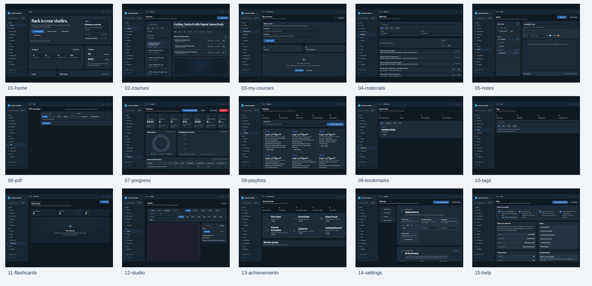
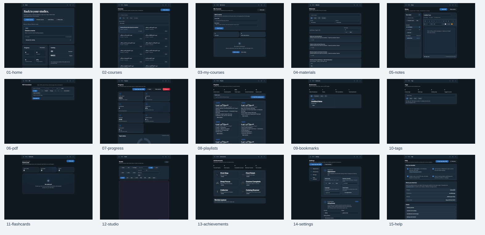
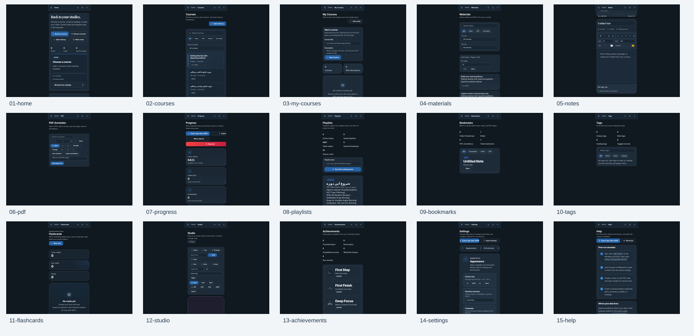
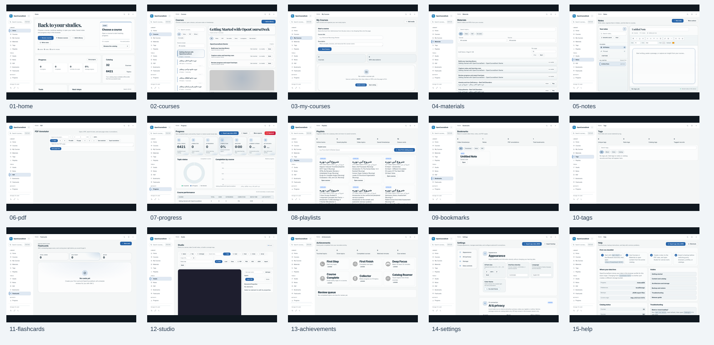
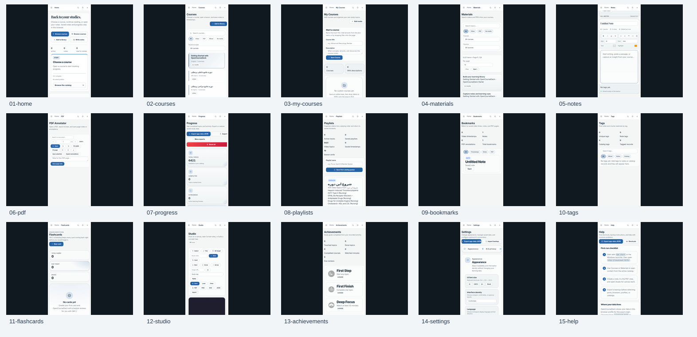
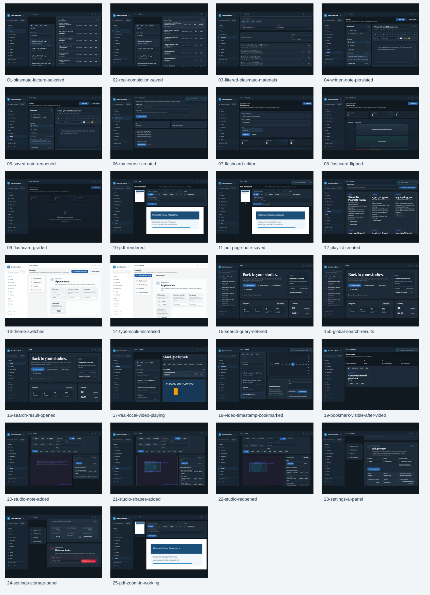
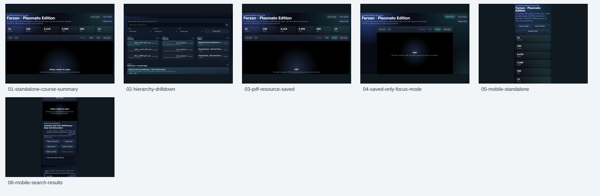

# Farzan Plasmato - Actual App Screenshots

These are unchanged Chrome/Playwright PNG captures from successful [visual acceptance run 38177326118](https://github.com/AmirrezaFarnamTaheri/Farzan/actions/runs/38177326118).
They document actual application states, not concepts, generated mockups, or claims of third-party media availability.
The functional video capture plays a browser-recorded WebM fixture through the native player; it does not prove remote media hosts are reachable.

There are 107 screenshots across 15 routes and working interaction states, plus seven contact sheets.
The complete SHA-256, dimensions, and byte counts are in [manifest.json](manifest.json).

## Overview contact sheets

### desktop overview

## desktop (15)

- [01 home](desktop/01-home.png)
- [02 courses](desktop/02-courses.png)
- [03 my courses](desktop/03-my-courses.png)
- [04 materials](desktop/04-materials.png)
- [05 notes](desktop/05-notes.png)
- [06 pdf](desktop/06-pdf.png)
- [07 progress](desktop/07-progress.png)
- [08 playlists](desktop/08-playlists.png)
- [09 bookmarks](desktop/09-bookmarks.png)
- [10 tags](desktop/10-tags.png)
- [11 flashcards](desktop/11-flashcards.png)
- [12 studio](desktop/12-studio.png)
- [13 achievements](desktop/13-achievements.png)
- [14 settings](desktop/14-settings.png)
- [15 help](desktop/15-help.png)

### tablet overview

## tablet (15)

- [01 home](tablet/01-home.png)
- [02 courses](tablet/02-courses.png)
- [03 my courses](tablet/03-my-courses.png)
- [04 materials](tablet/04-materials.png)
- [05 notes](tablet/05-notes.png)
- [06 pdf](tablet/06-pdf.png)
- [07 progress](tablet/07-progress.png)
- [08 playlists](tablet/08-playlists.png)
- [09 bookmarks](tablet/09-bookmarks.png)
- [10 tags](tablet/10-tags.png)
- [11 flashcards](tablet/11-flashcards.png)
- [12 studio](tablet/12-studio.png)
- [13 achievements](tablet/13-achievements.png)
- [14 settings](tablet/14-settings.png)
- [15 help](tablet/15-help.png)

### mobile overview

## mobile (15)

- [01 home](mobile/01-home.png)
- [02 courses](mobile/02-courses.png)
- [03 my courses](mobile/03-my-courses.png)
- [04 materials](mobile/04-materials.png)
- [05 notes](mobile/05-notes.png)
- [06 pdf](mobile/06-pdf.png)
- [07 progress](mobile/07-progress.png)
- [08 playlists](mobile/08-playlists.png)
- [09 bookmarks](mobile/09-bookmarks.png)
- [10 tags](mobile/10-tags.png)
- [11 flashcards](mobile/11-flashcards.png)
- [12 studio](mobile/12-studio.png)
- [13 achievements](mobile/13-achievements.png)
- [14 settings](mobile/14-settings.png)
- [15 help](mobile/15-help.png)

### light-desktop overview

## light-desktop (15)

- [01 home](light-desktop/01-home.png)
- [02 courses](light-desktop/02-courses.png)
- [03 my courses](light-desktop/03-my-courses.png)
- [04 materials](light-desktop/04-materials.png)
- [05 notes](light-desktop/05-notes.png)
- [06 pdf](light-desktop/06-pdf.png)
- [07 progress](light-desktop/07-progress.png)
- [08 playlists](light-desktop/08-playlists.png)
- [09 bookmarks](light-desktop/09-bookmarks.png)
- [10 tags](light-desktop/10-tags.png)
- [11 flashcards](light-desktop/11-flashcards.png)
- [12 studio](light-desktop/12-studio.png)
- [13 achievements](light-desktop/13-achievements.png)
- [14 settings](light-desktop/14-settings.png)
- [15 help](light-desktop/15-help.png)

### light-mobile overview

## light-mobile (15)

- [01 home](light-mobile/01-home.png)
- [02 courses](light-mobile/02-courses.png)
- [03 my courses](light-mobile/03-my-courses.png)
- [04 materials](light-mobile/04-materials.png)
- [05 notes](light-mobile/05-notes.png)
- [06 pdf](light-mobile/06-pdf.png)
- [07 progress](light-mobile/07-progress.png)
- [08 playlists](light-mobile/08-playlists.png)
- [09 bookmarks](light-mobile/09-bookmarks.png)
- [10 tags](light-mobile/10-tags.png)
- [11 flashcards](light-mobile/11-flashcards.png)
- [12 studio](light-mobile/12-studio.png)
- [13 achievements](light-mobile/13-achievements.png)
- [14 settings](light-mobile/14-settings.png)
- [15 help](light-mobile/15-help.png)

### functional overview

## functional (26)

- [01 plasmato lecture selected](functional/01-plasmato-lecture-selected.png)
- [02 real completion saved](functional/02-real-completion-saved.png)
- [03 filtered plasmato materials](functional/03-filtered-plasmato-materials.png)
- [04 written note persisted](functional/04-written-note-persisted.png)
- [05 saved note reopened](functional/05-saved-note-reopened.png)
- [06 my course created](functional/06-my-course-created.png)
- [07 flashcard editor](functional/07-flashcard-editor.png)
- [08 flashcard flipped](functional/08-flashcard-flipped.png)
- [09 flashcard graded](functional/09-flashcard-graded.png)
- [10 pdf rendered](functional/10-pdf-rendered.png)
- [11 pdf page note saved](functional/11-pdf-page-note-saved.png)
- [12 playlist created](functional/12-playlist-created.png)
- [13 theme switched](functional/13-theme-switched.png)
- [14 type scale increased](functional/14-type-scale-increased.png)
- [15 search query entered](functional/15-search-query-entered.png)
- [15b global search results](functional/15b-global-search-results.png)
- [16 search result opened](functional/16-search-result-opened.png)
- [17 real local video playing](functional/17-real-local-video-playing.png)
- [18 video timestamp bookmarked](functional/18-video-timestamp-bookmarked.png)
- [19 bookmark visible after video](functional/19-bookmark-visible-after-video.png)
- [20 studio note added](functional/20-studio-note-added.png)
- [21 studio shapes added](functional/21-studio-shapes-added.png)
- [22 studio reopened](functional/22-studio-reopened.png)
- [23 settings ai panel](functional/23-settings-ai-panel.png)
- [24 settings storage panel](functional/24-settings-storage-panel.png)
- [25 pdf zoom in working](functional/25-pdf-zoom-in-working.png)

### standalone overview

## standalone (6)

- [01 standalone course summary](standalone/01-standalone-course-summary.png)
- [02 hierarchy drilldown](standalone/02-hierarchy-drilldown.png)
- [03 pdf resource saved](standalone/03-pdf-resource-saved.png)
- [04 saved only focus mode](standalone/04-saved-only-focus-mode.png)
- [05 mobile standalone](standalone/05-mobile-standalone.png)
- [06 mobile search results](standalone/06-mobile-search-results.png)

